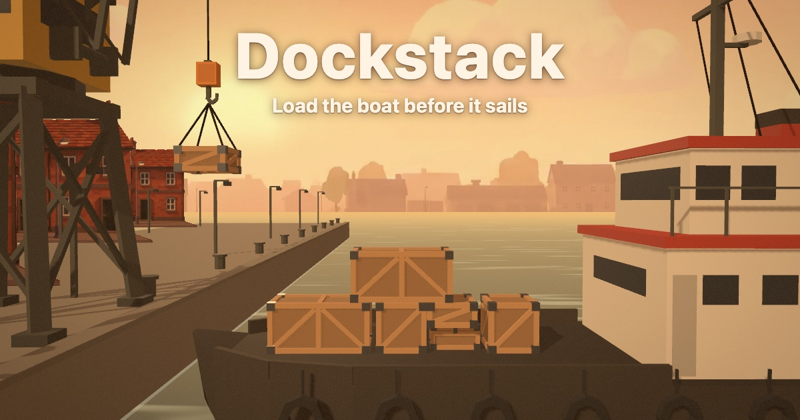

# Dockstack

Drop crates from a harbour crane onto a rocking boat before it sails.
A new shipment every day, the same for everyone.

**Play it at [dockstack.vercel.app](https://dockstack.vercel.app/).**



## How to play

1. Tap, click or press Space to drop the crate from the crane; gamepad A works too.
2. A crate stays only if its middle lands over the crate or deck below; otherwise it tips off and is lost.
3. The hook speeds up with each crate and the boat rocks on the swell, so time each drop.
4. Load all 15 crates.
   Most crates wins, then the tallest stack.

A run takes about 40 s.
Your best score for the day is kept in your browser, and the end card has a Share on X button.
The buttons in the top-right corner pause and restart a run; `P` or `Esc` pauses, `R` restarts and `M` mutes the sound.
A run also pauses when you switch tabs, and a restart deals the same shipment again.

## Run it locally

```bash
python3 -m http.server 8000      # then open http://127.0.0.1:8000/
node --test .                    # the simulation's 12 tests
```

URL parameters: `?seed=N` (default: today's UTC date as `YYYYMMDD`, the daily challenge), `?autostart`, `?mute` and `?debug` (frame rate, draw calls, triangles and seed, and an error in the console if drawing ever writes into the simulation).

## Publish it

```bash
./deploy.sh          # stage the site in dist/
./deploy.sh --prod   # stage it, then deploy dist/ to Vercel production
```

`deploy.sh` serves Three.js from the site itself instead of a CDN, preloads its modules, and adds the tags X reads for the link card.
Set `SITE` if the address ever changes, since X reads the card image from it.
`dist/` is not committed; the first deploy from a fresh clone needs `vercel link --project dockstack` inside it.

## Record a gameplay video

```bash
./deploy.sh && python3 -m http.server 8000 -d dist   # in one terminal
cd tools && npm install
node render-video.mjs http://127.0.0.1:8000/ ../media/run.mp4 1920 1080
```

[render-video.mjs](tools/render-video.mjs) renders a run frame by frame at 60 fps with the game's own sound, so the video never stutters however slow the machine is.
It replaces the page's clock with one that moves exactly 1/60 s per captured frame, logs every sound on that clock, and mixes the original sound files to match.
[autoplay.js](tools/autoplay.js) plays the run by reading `window.__game.state` and pressing Space like a player.
`media/` is not committed.

## How it is built

- **Page:** [index.html](index.html), one file on Three.js r170: the scene, the camera, the sound and the overlays.
- **Rules:** [sim.js](sim.js), the whole game in integers, so a server can replay a run exactly.
  A run is its seed plus the ticks at which the player let go of a crate, and `replay(seed, releases)` returns the score or refuses a release that could not have happened.
  The score is crates loaded times 1,000 plus the stack's height.
  A run played in Chrome replays to the same score and state hash in the page, in Node and in JavaScriptCore.
- **Models:** built in Blender by script, kept uncompressed in [source/models](source/models), and compressed into [assets/models](assets/models) by [build.sh](build.sh).
- **Images and sound:** generated on fal; every asset's source and terms are in [CREDITS.md](CREDITS.md).

Dockstack began as a calibration run in [x-gaming](https://github.com/imDev2023/x-gaming), where the [full build record](https://github.com/imDev2023/x-gaming/blob/main/calibration/2026-11-06-video2game/README.md) lives: the concept video, the spec, the Blender scripts, the playtests and every fal call with its cost.

## Licence

Use it however you want: copy it, change it, sell it or build your own game from it, with no credit required.

- **Code:** MIT No Attribution, in [LICENSE](LICENSE).
- **Models, images, sounds, icon and link card:** dedicated to the public domain under CC0 1.0, in [LICENSE-ASSETS](LICENSE-ASSETS).
- **One condition we cannot waive:** the page began from the MIT-licensed Video2Game template, so copies of the code keep its notice, in [NOTICE](NOTICE).
- The images and sounds were generated on fal, and those services' own output terms may also apply; see [CREDITS.md](CREDITS.md).

## Next

A daily top 10 with no sign-in, accepting only scores the server has replayed: [x-gaming#5](https://github.com/imDev2023/x-gaming/issues/5).
